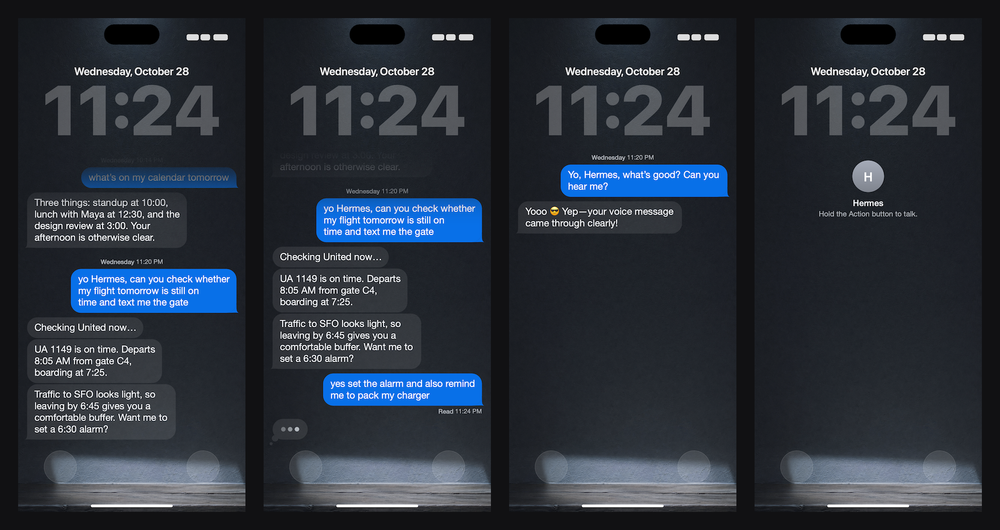

# Hermes Lock Screen

Your chat with your AI agent, drawn on your iPhone's Lock Screen. It looks like Messages, and it updates by itself
whenever your agent texts you. You can read the reply without unlocking your phone.



## Two ways to set it up

- **iPhone only** (the steps below). The Shortcuts app draws the chat on your iPhone. Each update takes about half a
  minute, and your own messages can show a few minutes late.
- **With a Mac** ([mac/README.md](mac/README.md)). If you have a Mac that stays on and has your Messages, it reads
  the chat straight from Messages and draws it. The iPhone only fetches the picture, over Tailscale, so the Lock
  Screen is an exact copy of the chat, ready in under a second.

## Quick start

Paste this prompt into the agent of your choice:

```text
Help me set up Hermes Lock Screen on my iPhone. The project is here:
https://github.com/LemonFace0309/hermes-lockscreen

Read README.md, SETUP.md and mac/README.md in that repo first. Then guide me
through the setup:
- Before anything else, ask me which iOS version my iPhone runs, the exact
  name of my AI agent's contact in Messages, and whether I have a Mac that
  stays on with my Messages. If I do, follow mac/README.md.
- Give me one step at a time, with the exact buttons to tap.
- Wait until I say it worked before you give me the next step.
- If something fails, ask me for a screenshot and use the "If something goes
  wrong" section of SETUP.md to fix it.
```

Or follow the steps below yourself. It takes about 15 minutes.

## What you need

- An iPhone on iOS 26 or newer.
- An AI agent you text in Messages (iMessage), saved as a contact. It was built for a Hermes agent, but any contact
  works.
- iCloud Drive turned on for the Shortcuts app.

## How it works

An iPhone can't show a chat on the Lock Screen by itself, but the Shortcuts app can change your wallpaper. So:

1. Your agent texts you.
2. An automation in the Shortcuts app sees the text and runs a shortcut.
3. The shortcut draws your chat as a picture on top of a wall photo, and sets that picture as your Lock Screen.

The new picture shows up a little after the message, usually within half a minute. Shortcuts is slow at drawing.

## Set it up

### 1. Get the files

1. On your iPhone, tap **[Hermes.zip](https://github.com/LemonFace0309/hermes-lockscreen/raw/main/Hermes.zip)**, then
   **Download**.
2. Open the **Files** app, go to **Downloads** and tap **Hermes.zip**. It turns into a folder called **Hermes**.
3. Touch and hold the **Hermes** folder, tap **Move**, choose **iCloud Drive › Shortcuts**, then tap **Move**.
4. Touch and hold the folder again and tap **Keep Downloaded**, if you see it.

No **Shortcuts** folder in iCloud Drive? Turn on iCloud Drive for the Shortcuts app in **Settings → your name →
iCloud**, then look again. Don't make the folder yourself: it has to be the one the Shortcuts app made.

### 2. Make a Lock Screen for it

The shortcut can only change a Lock Screen made from a single photo.

1. In Files, open **Hermes** and tap **wall.png**. Tap the share button, then **Save Image**.
2. Go to **Settings → Wallpaper → Add New Wallpaper → Photos**, pick that image and tap **Add**.
3. Tap **Set as Wallpaper Pair**, or **Customize Home Screen** if you want a different Home Screen. The shortcut only
   changes the Lock Screen.

### 3. Add the three shortcuts

In Files, open **iCloud Drive › Shortcuts › Hermes**. Tap each of these and tap **Add Shortcut**:

- **Hermes Chat Renderer**. When it asks for your agent's name, type it exactly like the contact in Messages.
- **Hermes Lock Screen**.
- **Talk to Hermes**. When it asks, pick your agent's contact.

### 4. Pick the Lock Screen

1. Open the **Shortcuts** app. On **Hermes Lock Screen**, tap **···**.
2. Scroll to the **Set Wallpaper Photo** action. There's only one.
3. Tap the wallpaper in it and choose the Lock Screen you made in step 2. Tap **Done**.

### 5. Run it once

1. On **Hermes Chat Renderer**, tap **···**, then tap **▶** at the bottom. When it asks to access Messages, tap
   **Always Allow**. Wait until it's done, about 30 seconds.
2. Do the same with **Hermes Lock Screen**.

Lock your iPhone: your chat is there. It fills in as you and your agent keep talking.

### 6. Make it update by itself

1. In the Shortcuts app, tap **Automation**, then **+**.
2. Choose **Message**. Tap **Sender**, pick your agent and tap **Done**.
3. Choose **Run Immediately** and turn off **Notify When Run**. Tap **Next**.
4. Tap **New Blank Automation**, then **Add Action**. Search for **Run Shortcut** and tap it.
5. Tap **Shortcut** in the action and choose **Hermes Lock Screen**.
6. Tap the small arrow on the action, tap **Input** and choose **Shortcut Input**. Tap **Done**.

Now text your agent and look at your Lock Screen.

### Extras

- **Talk with the Action button**: go to **Settings → Action Button → Shortcut → Talk to Hermes**. Hold the button,
  talk, let go. It sends a voice note and shows your words under it.
- **A wall that changes with the sun**: see [step 7 in SETUP.md](SETUP.md#7-make-the-wall-follow-the-light).
- **iOS 27** does a few steps differently: see [SETUP.md](SETUP.md#ios-27).

## Good to know

- Your own messages show up when your agent reacts to them or replies. iOS only runs automations for messages you
  receive, so the shortcut reads Messages to find yours.
- On iOS 26, Messages doesn't say who sent a message. The shortcut works it out: your agent's messages arrive first as
  notifications, so anything else is yours. If one of your agent's automations never ran, that message can end up on
  your side.
- Voice notes you send from Messages (not from Talk to Hermes) show up once your agent reacts to them. Photos from
  your agent show as "📎 Attachment".
- The chat keeps the newest 60 bubbles. Text `/new` to your agent to start a clean chat on the Lock Screen.
- The shortcuts don't send your chat anywhere. It's saved in your own iCloud Drive, in **Shortcuts › Hermes**.

## Something wrong?

See [If something goes wrong](SETUP.md#if-something-goes-wrong). The file `update-status.json` in the Hermes folder
says what the last update did and where it stopped.

## For developers

The three shortcuts aren't edited by hand. `tools/build_shortcut.py` writes them, and every number comes from
`design/tokens.json`.

- `tools/package.sh` builds `Hermes.zip`. It needs a Mac with the Shortcuts app (to sign the shortcuts), Swift and
  Node.js 18 or newer.
- `python3 tools/test_scenarios.py` plays 77 situations through a simulated iPhone (`tools/sim.mjs`) that behaves
  like iOS 26: bursts of messages, reactions, voice notes, time zones, missed automations.
- `python3 tools/profile_steps.py` shows how many steps, file reads and saves each kind of update takes.
- [docs/how-it-works.md](docs/how-it-works.md) explains the design, what iOS 26 allows, and what's slow.
- `mac/` is the Mac version: a Swift reader and server (`swift build --package-path mac`), `install.sh`, and
  `build_phone_shortcut.py`, which builds the iPhone's Hermes Lock Screen for it. See [mac/README.md](mac/README.md).

## License

MIT. See [LICENSE](LICENSE).
